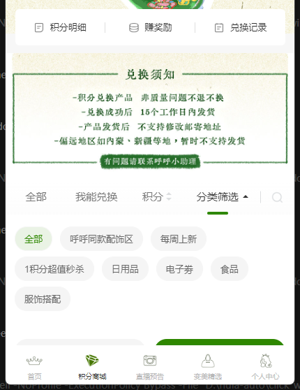

# 微信小程序每日签到自动化（学习项目）

一个运行在 **Windows** 上的微信小程序签到/积分任务自动化工具，**目前只针对“呼啦圈会员中心（hula）”和“姐姐很贵（jiejie）”这两款小程序**。它从本机微信的小程序容器内存里读取登录 token，然后直接调用小程序后端接口完成签到、发布心愿、订阅/查看直播等任务；积分可以在小程序商城里兑换生活用品、食品、电子券等。

> **目前只支持：呼啦圈会员中心（hula）、姐姐很贵（jiejie）。**
>
> 用途：每天自动签到获取积分，积分可兑换生活用品、食品、电子券等，具体以小程序商城实际库存为准。
>
> **白嫖的用起来最香。**

> **请先阅读 [DISCLAIMER.md](DISCLAIMER.md)。** 本项目仅用于学习自动化技术，与腾讯/微信/星云有客/相关品牌无关，也未获得授权。自动化操作可能导致账号被风控、积分被回收甚至封号，使用风险自负。请勿用于商业代签、批量薅羊毛或违法用途。

## 5 分钟快速开始

> 仅支持 **Windows 10/11 64 位** + **微信 PC 版**。第一次使用请按顺序操作。

1. 安装 [Node.js](https://nodejs.org/) 18+，安装时勾选 **Add to PATH**。
2. 下载或克隆本仓库到本地，例如 `D:\wechat-mini-checkin`。
3. 双击 `setup.bat`，生成 `config/config.json` 和 `data/`。
4. 登录微信，并**分别打开这两款小程序一次**：呼啦圈会员中心、姐姐很贵。
5. 双击 `harvest.bat`，抓取并保存 token。
6. 双击 `doctor.bat`，确认 Node、微信、token 都正常。
7. 双击 `daily.bat`，手动跑一次签到。
8. 可选：双击 `install_task.bat`，设置每天自动签到 + 开机补跑。

详细配置和多账号说明见下文「快速开始」「日常使用」「多账号配置」。

## 功能

- 每日自动签到（目前支持呼啦圈会员中心、姐姐很贵）
- 自动发布心愿并领取心愿奖励
- 自动订阅直播预告、查看直播预告并领取奖励（按小程序配置）
- 积分可兑换生活用品、食品、电子券等（以小程序商城实际库存为准）
- 多账号配置：每个微信账号一份 token/日志/状态，互不干扰
- Windows 通知：成功/失败都会弹 toast，并写入状态文件
- 可选手机推送：支持 ntfy / Server酱 / PushPlus / 飞书 webhook / 通用 webhook
- 一键体检：`doctor.bat` 检查 Node、微信、token、配置
- 定时任务：每天 9:00 自动跑；开机/错过时间自动补跑

## 截图

| 呼啦圈会员中心 | 姐姐很贵 |
|---|---|
|  |  |

**积分商城 · 兑换分类（日用品、食品、电子券等）**



## 环境要求

- Windows 10/11 **64 位**
- [Node.js](https://nodejs.org/) **18+**（安装时勾选 Add to PATH）
- 微信 PC 版（4.x 的 `Weixin.exe` 或 3.x 的 `WeChat.exe`），已登录
  - 自动打开小程序按微信 **4.x** 的窗口/数据目录适配；3.x 可能需要手动打开小程序
- Windows PowerShell 5.1+（系统自带，必须是 64 位）
- **目前只支持两款小程序：呼啦圈会员中心（hula）、姐姐很贵（jiejie）。**
  - 它们使用同一套 **星云有客 / iyouke** 后端模板。
  - 其他小程序需要自行适配，不保证能用。

> 这不是“任意小程序都能签”的通用工具。换小程序需要它使用同样的 `/dtapi/...` 接口和同样的登录方式，并在 `config/apps.json` 里配置 appid/version。

## 目录结构

```
.
├─ setup.bat               首次配置
├─ harvest.bat             从微信内存抓取并保存 token
├─ doctor.bat              环境/配置/token 体检
├─ daily.bat               手动跑一次每日任务
├─ install_task.bat        安装每天 9:00 + 每 30 分钟补跑的计划任务
├─ uninstall_task.bat      移除计划任务
├─ config/
│  ├─ apps.json            小程序定义（appid、版本、任务配额）
│  ├─ config.example.json  账号/通知配置模板
│  └─ config.json          你自己的配置（setup.bat 生成，已被 .gitignore 忽略）
├─ src/
│  ├─ config.js            配置/路径加载
│  ├─ hula.js              接口调用与签到逻辑
│  └─ run-daily.js         每日任务编排（多账号、刷新、通知）
├─ tools/
│  ├─ scan_tokens.ps1      扫描 WeChatAppEx 内存
│  ├─ save_tokens.js       验证并保存 token
│  ├─ refresh_token_auto.ps1  token 失效时自动刷新
│  ├─ open_miniprogram.ps1 自动打开小程序，触发新的 wx.login
│  ├─ harvest.js           抓取 token 的入口
│  ├─ notify.ps1           Windows toast + 可选 webhook
│  ├─ catchup.ps1          错过 9:00 时补跑
│  ├─ install_task.ps1     创建计划任务
│  ├─ uninstall_task.ps1   删除计划任务
│  └─ doctor.ps1           体检
├─ data/                   运行期数据（token、日志、状态），已被 .gitignore 忽略
└─ docs/                   配置与原理说明
```

## 快速开始

### 1. 安装 Node.js

安装 Node.js 18+，然后在 cmd 里确认：

```bat
node -v
```

### 2. 首次配置

双击 `setup.bat`，它会：

- 创建 `config/config.json`（从 `config.example.json` 复制）
- 创建 `data/` 目录
- 打印默认账号和下一步操作

### 3. 登录微信并打开小程序

在电脑上登录微信，然后**分别打开**目标小程序一次（例如“呼啦圈会员中心”和“姐姐很贵”）。打开一次是为了让微信容器里出现新的登录 token。

### 4. 抓取 token

双击 `harvest.bat`，或者在 cmd 里运行：

```bat
harvest.bat --account default
```

它会扫描 `WeChatAppEx.exe` 的内存，把服务端认可的 token 保存到：

```
data/accounts/default/tokens/hula.json
data/accounts/default/tokens/jiejie.json
```

> token 是账号的临时登录凭证，等同于密码。不要提交到 GitHub，不要发给别人。`data/` 已经在 `.gitignore` 里。

### 5. 体检并试跑

```bat
doctor.bat
daily.bat
```

`doctor.bat` 会逐项检查 Node、微信进程、小程序容器、每个账号/小程序的 token。`daily.bat` 会真正执行签到和积分任务，并弹通知。

### 6. 设置每天自动跑（可选）

双击 `install_task.bat`。它会创建：

- `WeChatMiniCheckin`：每天 09:00 运行 `daily.bat`（时间取 `config/config.json` 的 `startHour`；改完重新运行 `install_task.bat`），如果到点时电脑关机，开机后会尽快补跑
- `WeChatMiniCatchup`：每 30 分钟检查一次，如果今天还没成功就补跑

创建计划任务可能需要管理员权限；如果失败，右键“以管理员身份运行” PowerShell，再执行 `install_task.bat`。

## 日常使用

### 全自动（推荐）

装好计划任务后，不需要每天手动操作：

1. 每天 `startHour`（默认 9:00）`WeChatMiniCheckin` 自动运行 `daily.bat`。
2. 如果电脑那时关机，`WeChatMiniCatchup` 每 30 分钟检查一次，开机后补跑。
3. token 过期时，`refresh_token_auto.ps1` 会自动启动微信、在微信搜索里打开目标小程序，
   等小程序重新 `wx.login`，再扫描内存、保存新 token，然后继续签到。
4. 跑完会弹 Windows 通知，成功/失败都有；结果同时写到 `data/last_status.txt`。

自动刷新 token 只在 token 失效时发生，通常会短暂操作微信窗口约 20–60 秒；
平时 token 还有效时不会碰微信。

### 手动跑一次

```bat
daily.bat
daily.bat --account second
daily.bat --all-accounts
daily.bat --app hula
```

### 查看结果

- Windows 通知（右下角，也会留在通知中心）
- `data/last_status.txt`：最近一次的人类可读摘要
- `data/last_run.json`：最近一次的机器可读结果
- `data/logs/daily.log`：每日汇总
- `data/logs/refresh.log`：token 刷新过程
- `data/accounts/<id>/logs/<app>.log`：每个账号/小程序的详细日志

### token 过期时会发生什么

token 有效期约 24 小时。过期后：

1. `refresh_token_auto.ps1` 先问服务端，确认 token 已失效；
2. 启动微信，找到微信主窗口；
3. 在微信搜索里自动打开需要刷新 token 的小程序（`open_miniprogram.ps1`）；
4. 等 6 秒，让小程序完成 `wx.login` / `appLogin`；
5. 扫描 `WeChatAppEx.exe` 内存，保存服务端接受的新 token；
6. 继续执行签到。

如果自动打开失败，日志会写 `failed to open ...`，并继续尝试扫描；
扫描不到新 token 时会发失败通知。

### 自动刷新失败怎么办

最常见的原因：

- 微信退到了扫码登录页：需要手机扫码登录微信；
- 电脑锁屏/休眠：UI 自动化无法点击，解锁后重试；
- 微信/小程序 UI 改版：自动点击的位置失效，手动打开小程序一次即可；
- 微信 3.x：自动打开按 4.x 的数据目录适配，3.x 建议手动打开小程序。

处理步骤：

1. 解锁电脑，确认微信已登录；
2. 手动打开目标小程序一次；
3. 运行 `harvest.bat --account <id>`（重新抓 token）；
4. 运行 `daily.bat` 补签。

如果只是偶尔失败，`WeChatMiniCatchup` 会在下一次检查时自动补跑。

## 多账号配置

编辑 `config/config.json`：

```json
{
  "wechatPath": "",
  "startHour": 9,
  "currentAccount": "default",
  "accounts": [
    {
      "id": "default",
      "name": "我的账号",
      "apps": ["hula", "jiejie"]
    },
    {
      "id": "second",
      "name": "第二个微信",
      "apps": ["hula", "jiejie"]
    }
  ],
  "notify": {
    "toast": true,
    "webhook": {
      "type": "",
      "url": "",
      "token": ""
    }
  }
}
```

每个账号的数据分别在：

```
data/accounts/<id>/tokens/
data/accounts/<id>/logs/
data/accounts/<id>/state/
```

### 切换账号抓 token

微信 PC 同一时间只能登录一个账号。要给第二个账号抓 token：

1. 在微信里切换到第二个账号；
2. 打开目标小程序一次；
3. 把 `config/config.json` 的 `currentAccount` 改成 `second`；
4. 运行 `harvest.bat --account second`；
5. 如果切回第一个账号，把 `currentAccount` 改回 `default`。

`currentAccount` 表示“当前微信登录的是哪个账号”。只有这个账号能抓取/刷新 token；`daily.bat` 仍会用其他账号已保存且未过期的 token 跑任务，但不会替它们刷新。

每天运行时：

```bat
daily.bat                     REM 所有账号
daily.bat --account second    REM 只跑一个账号
daily.bat --all-accounts      REM 显式跑所有账号
```

> 限制：token 过期后，只有**当前登录的那个微信账号**能刷新自己的 token。另一个账号的 token 如果还有效，可以继续跑；如果已过期，需要切回那个账号重新 `harvest`。这是微信登录态决定的，不是代码能绕过的。

## 配置小程序

`config/apps.json` 里已经预置了两个示例：

```json
{
  "base": "smp-api.iyouke.com",
  "apps": [
    {
      "key": "hula",
      "name": "呼啦圈会员中心",
      "appid": "wx89a714fb03b61b99",
      "version": "2.33.3",
      "pkgVersion": "43",
      "wish": { "cycle": "every_day", "limit": 3, "cycleValue": 3, "points": 1 },
      "signPoints": 1,
      "hasViewLiveTask": true,
      "subscribePoints": 1
    }
  ]
}
```

字段说明：

| 字段 | 含义 |
|---|---|
| `key` | 内部标识，用在命令行和 `data/accounts/<id>/tokens/<key>.json` |
| `name` | 显示名称 |
| `appid` | 小程序 appid |
| `version` | 请求头里的版本号 |
| `pkgVersion` | referer 里的包版本 |
| `wish.limit` | 每个周期最多发几条心愿 |
| `wish.cycleValue` | 每个周期最多领几次心愿奖励 |
| `signPoints` / `subscribePoints` | 仅用于说明/展示 |
| `hasViewLiveTask` | 是否有“查看直播预告”任务（hula 有，jiejie 没有） |

新增小程序时，把它加到 `apps` 数组，并在 `config/config.json` 对应账号的 `apps` 里加上它的 `key`。如果它不是同一套 iyouke 接口，这个工具不能直接用。

## 常用命令

```bat
node src/hula.js hula status
node src/hula.js hula sign
node src/hula.js hula daily
node src/hula.js --account second jiejie daily

node src/run-daily.js
node src/run-daily.js --account second
node src/run-daily.js --app hula --no-notify

node tools/harvest.js --account default
```

## 通知

默认弹 Windows toast，并写入：

```
data/last_status.txt
data/last_status.json
data/last_run.json
data/logs/daily.log
data/logs/notify.log
data/logs/refresh.log
```

### 手机推送

编辑 `config/config.json` 的 `notify.webhook`：

```json
"webhook": {
  "type": "ntfy",
  "url": "https://ntfy.sh/your-random-topic"
}
```

支持：

| type | 说明 |
|---|---|
| `ntfy` | POST 到 ntfy topic，手机装 ntfy App 或打开 topic 页面订阅 |
| `serverchan` | `url` 填 `https://sctapi.ftqq.com/<SendKey>.send` |
| `pushplus` | `url` 填 `https://www.pushplus.plus/send`，`token` 填 PushPlus token |
| `feishu` | `url` 填飞书群机器人 webhook |
| `generic` | POST JSON `{title, message, kind}` 到任意 URL |

不需要手机推送就把 `type` 和 `url` 留空。

## 常见问题

### `token invalid` / `no candidate accepted`

1. 确认微信已登录；
2. 在微信里打开目标小程序一次（不是只打开微信）；
3. 运行 `harvest.bat --account <id>`；
4. 再运行 `doctor.bat`。

如果还是失败，可能是：
- 微信版本/小程序版本变了，接口或内存结构变了；
- token 已过期，微信没有重新 `appLogin`；
- 登录的不是配置对应的微信账号。

### `no process WeChatAppEx`

微信没有运行，或者小程序容器还没启动。登录微信并打开小程序一次。

### `this script must run in 64-bit PowerShell`

用 64 位 Windows PowerShell 运行，不要用 x86 版本。`harvest.bat` 默认调用系统 PowerShell；如果系统默认是 32 位，请在 64 位 PowerShell 里手动执行 `tools/scan_tokens.ps1`。

### `WeChat not found`

在 `config/config.json` 里设置：

```json
"wechatPath": "C:\\Program Files\\Tencent\\Weixin\\Weixin.exe"
```

路径用双反斜杠。

### 计划任务没有跑

- 电脑必须在运行；关机时任务不会执行，但 `WeChatMiniCatchup` 会在开机后补跑。
- 检查任务计划程序里的 `WeChatMiniCheckin` / `WeChatMiniCatchup` 是否存在、是否启用。
- 创建任务可能需要管理员权限。
- 手动运行 `daily.bat` 看是否有报错。

### 会不会封号？

有风险。自动化调用私有接口、读取微信进程内存都不是官方支持的行为。请阅读 [DISCLAIMER.md](DISCLAIMER.md)，不要用于商业代签或批量操作。

## 安全与隐私

- 不收集账号密码；只读取微信已经登录后产生的 bearer token。
- token、日志、订阅状态全部保存在本机 `data/`，不会上传到任何服务器（除非你自己配置了 webhook）。
- `.gitignore` 已排除 `data/` 和 `config/config.json`。提交前请再次确认没有把 token 提交上去。
- 读取进程内存可能被杀毒软件误报；本项目不使用证书、不接管微信聊天流量。
- 如果你要给别人使用，建议每人使用自己的电脑和自己的微信账号，不要共享 token。

## 工作原理（简述）

1. `scan_tokens.ps1` 用 `ReadProcessMemory` 扫描 `WeChatAppEx.exe` 里形如 bearer token 的字符串；
2. `save_tokens.js` 逐个拿候选 token 调 `/dtapi/pointsSign/user/pointsInfo/query`，服务端接受的才保存；
3. `src/hula.js` 用保存的 token 调小程序后端接口完成签到/心愿/直播任务；
4. token 过期时，`refresh_token_auto.ps1` 启动微信、找到主窗口、自动打开目标小程序触发 `wx.login`，再重新扫描并保存新 token；
5. `run-daily.js` 负责多账号编排、结果汇总和通知。

更多接口细节见 [docs/TECHNICAL.md](docs/TECHNICAL.md)。

## 文档

- [配置说明](docs/CONFIG.md)
- [常见问题](docs/FAQ.md)
- [技术说明](docs/TECHNICAL.md)

## License

[MIT](LICENSE)。使用前请阅读 [DISCLAIMER.md](DISCLAIMER.md)。
